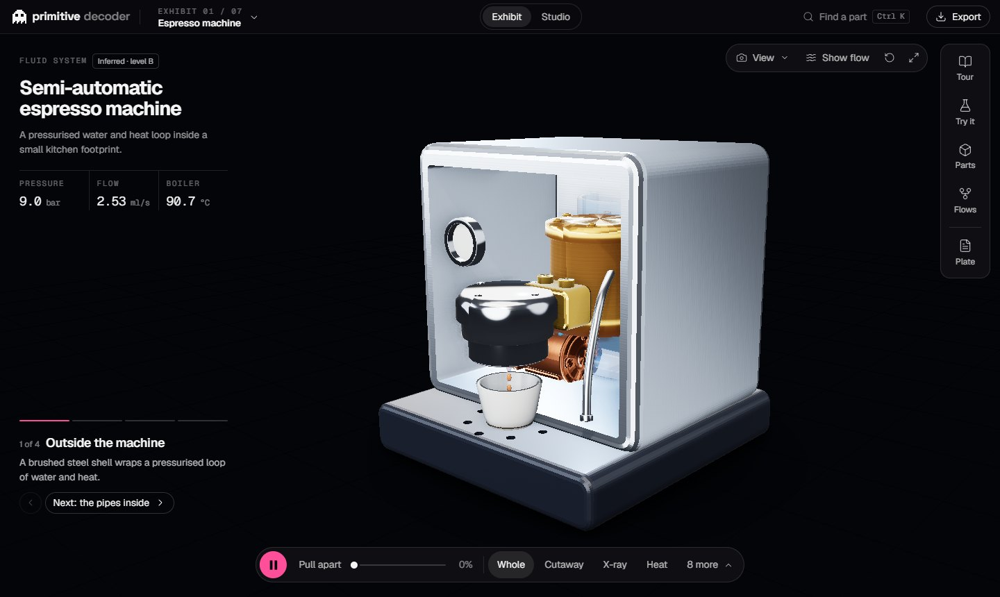
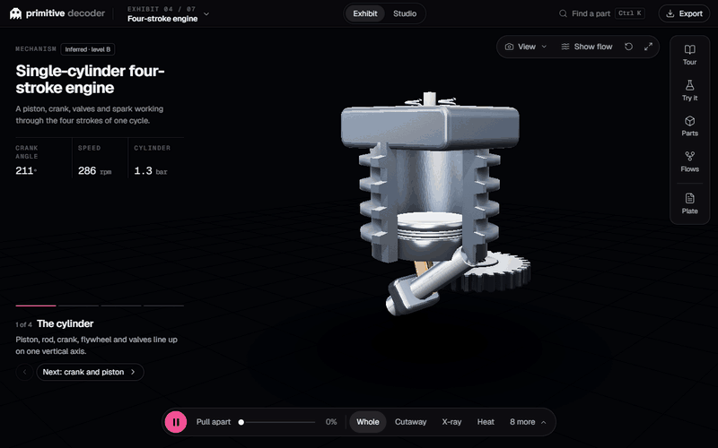
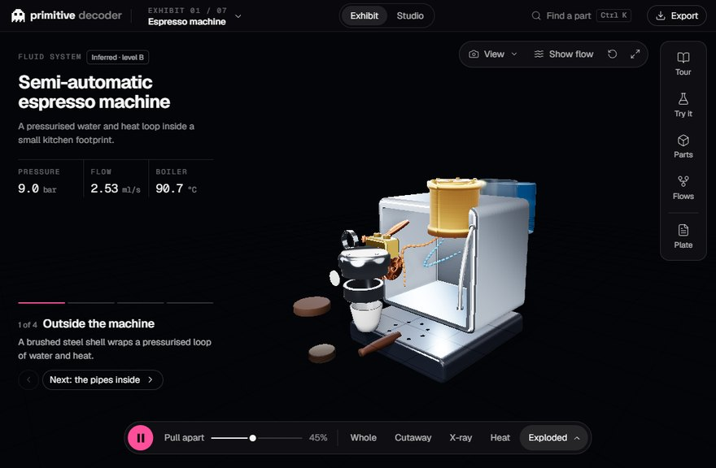
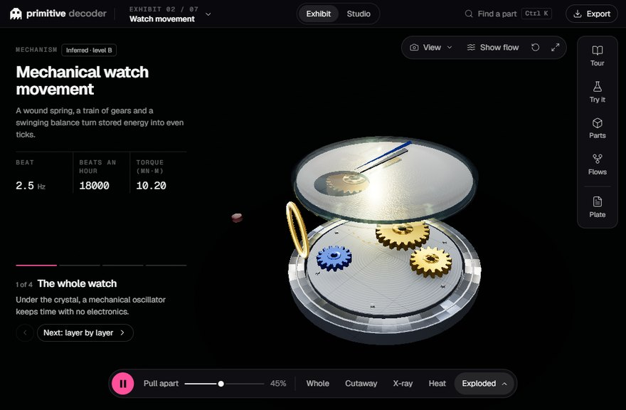
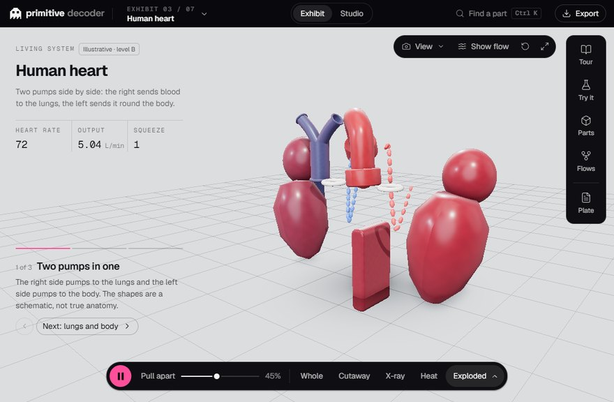
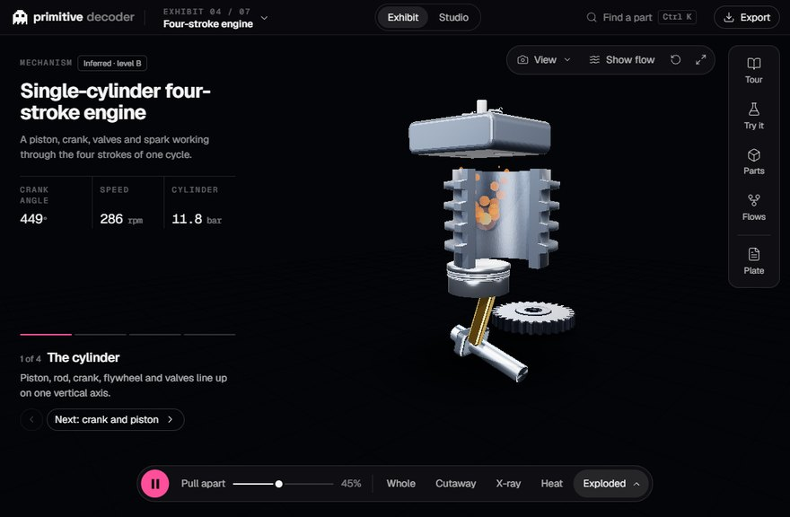
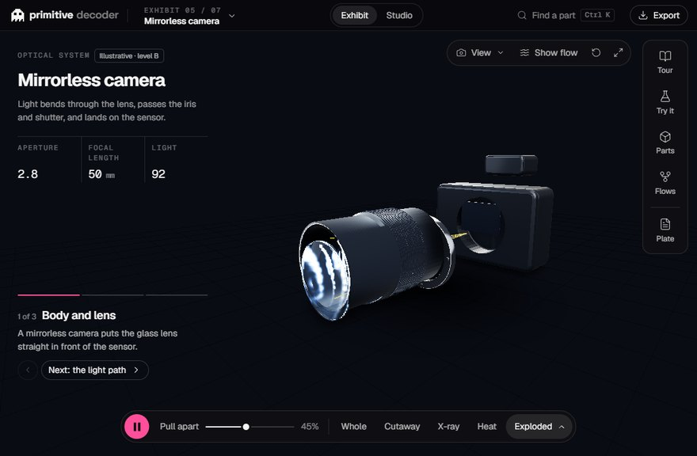
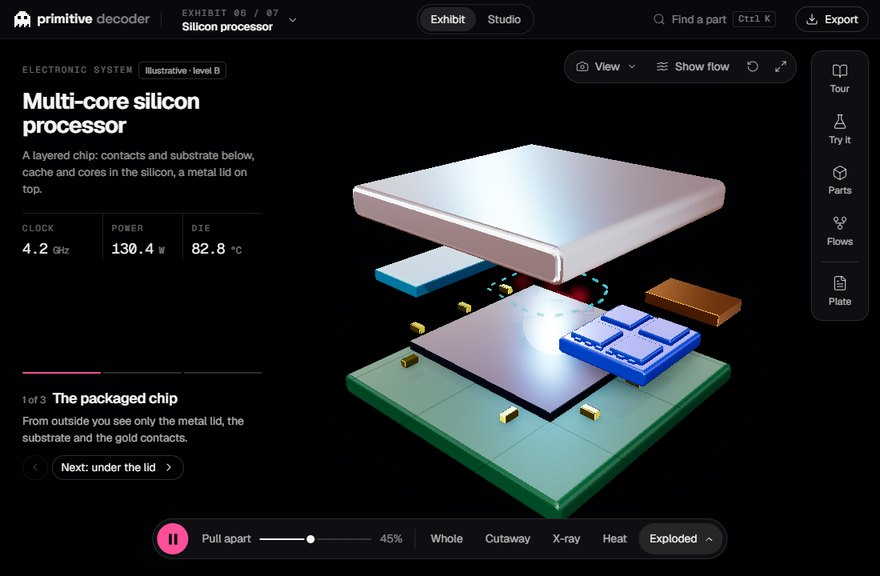
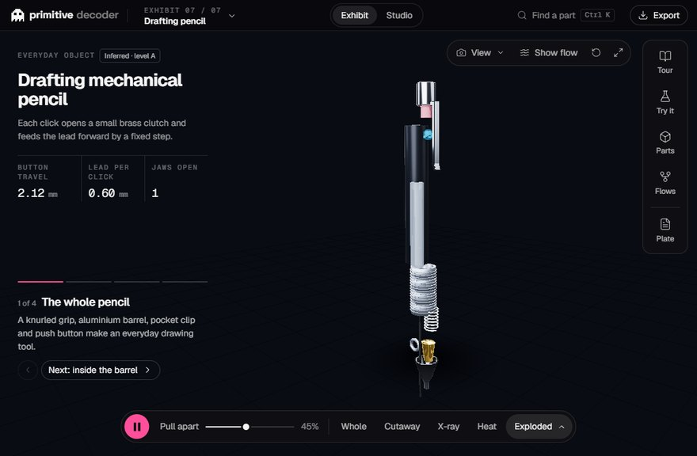
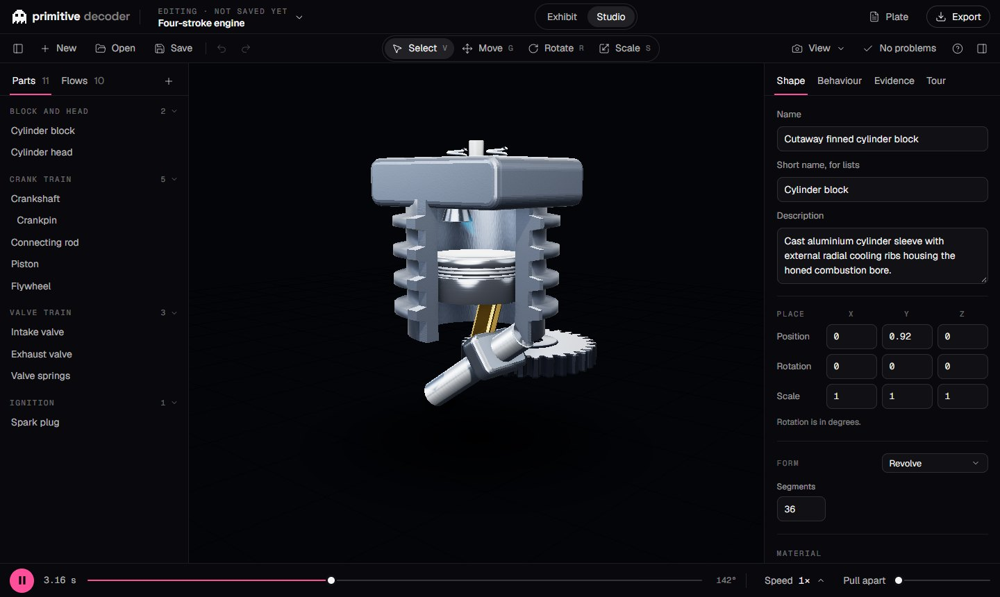

<div align="center">


# primitive decoder

**Explain how things work, in 3D.**

Describe a machine, a device or an organ as plain data. Get an interactive exhibit you can pull apart, run and trace, then ship it as one HTML file that works offline.

[](https://github.com/Primitivelabai/decoder/actions/workflows/ci.yml)
[](LICENSE)
[](https://primitivelabai.github.io/decoder/)

[**Open the live demo**](https://primitivelabai.github.io/decoder/) · [Run it locally](#run-it) · [Use it from an agent](#use-it-from-an-agent)



</div>

## What it does



- **Pull any assembly apart.** Parts separate along their real disassembly paths, subsystem by subsystem.
- **Run the physics.** A declarative simulation drives every moving part: slider-cranks, ODEs, lookup tables and state machines. No code is evaluated, ever.
- **Trace cause and effect.** Torque, heat, fluid, signal and control links between parts, with upstream and downstream tracing and feedback-loop detection.
- **Twelve ways to look.** Cutaway, section, X-ray, thermal, wireframe, layered, isolated and more.
- **Print a plate.** Six vector illustration styles, from patent drawing to museum plate, generated from the 3D geometry.
- **Export anything.** Standalone HTML, GLB, glTF, OBJ, STL, faceted STEP, SVG, PNG and the source `.decoder.json`.
- **Show your sources.** Every part carries an evidence label, and documented claims must cite where they came from.

<br clear="right">

## Seven exhibits included

|                                                                                |                                                                                     |                                                                                  |
| :----------------------------------------------------------------------------: | :---------------------------------------------------------------------------------: | :------------------------------------------------------------------------------: |
|      |  |                  |
|                              **Espresso machine**                              |                                **Mechanical watch**                                 |                                 **Human heart**                                  |
|  |            |  |
|                             **Four-stroke engine**                             |                                **Mirrorless camera**                                |                                  **Processor**                                   |
|    |                                                                                     |                                                                                  |
|                             **Mechanical pencil**                              |                                                                                     |                                                                                  |

## Studio



The Studio is where you build or change an exhibit. Everything in it edits one `.decoder.json` file, and every change shows up in the 3D view straight away. Switch to it with **Studio** in the top bar; the help button (**?**) in the tool row walks you through it.

| Panel                 | What it's for                                                                                                                                                                     |
| :-------------------- | :-------------------------------------------------------------------------------------------------------------------------------------------------------------------------------- |
| **Parts** (left)      | Every part, grouped by subsystem. Click to select, use the eye to hide a part and see inside, **+** to add one.                                                                   |
| **Flows** (left)      | How parts drive each other: force, heat, liquid, signal and control. Select a part to trace what feeds it and what it feeds, and spot feedback loops.                             |
| **3D view** (centre)  | Click parts to select them. **Move** (G), **Rotate** (R) and **Scale** (S) drag the selected part; **Select** (V) goes back. **View** holds camera, lighting and render settings. |
| **Shape** (right)     | Name, short name, description, place, form and material of the selected part.                                                                                                     |
| **Behaviour** (right) | The inputs a viewer can change, the live readings the simulation computes, and the working behind them.                                                                           |
| **Evidence** (right)  | How sure we are about the part (observed, documented, inferred, illustrative or unknown) and the sources behind it.                                                               |
| **Tour** (right)      | The steps the exhibit walks a viewer through.                                                                                                                                     |
| **Status** (tool row) | Anything that would stop the exhibit exporting cleanly. It reads "No problems" or the count; click it for the list.                                                               |
| **Timeline** (bottom) | Play, pause, scrub through one cycle, change the speed and pull the parts apart.                                                                                                  |

**New** starts from a blank template, **Open** loads a `.decoder.json`, **Save** keeps your work in this browser, and **Export** in the top bar writes standalone HTML, 3D files, images or the source file. **Plate** draws a printable technical illustration of the exhibit.

## Run it

Requires Node.js 22.12 or newer and a WebGL2 browser.

```sh
npm install
npm run dev
```

Open `http://127.0.0.1:3000`.

## Command line

Install the `decoder` command from npm (Node.js 22.12 or newer):

```sh
npm install -g primitive-decoder
```

```sh
decoder init example.decoder.json "Example system"
decoder validate example.decoder.json
decoder preview example.decoder.json
decoder render example.decoder.json plate.svg patent
decoder package example.decoder.json exhibit.html
```

Or run it once without installing: `npx primitive-decoder validate example.decoder.json`. In a checkout of this repository, use `npm run decoder -- <command>`.

The same engine is available as a library:

```js
import { DecoderSDK } from 'primitive-decoder';

const report = new DecoderSDK().validate(project);
```

`package` writes one self-contained HTML file: the same renderer and simulation as the Studio, the project data, and a vector fallback plate for devices without WebGL. It makes no network requests.

The `.decoder.json` format is defined in `src/engine/schema.ts`. See `docs/ARCHITECTURE.md` for how the engine fits together.

## Use it from an agent

`skills/decoder` is an agent skill (a `SKILL.md` in the open skills format) that teaches an agent to author, validate and package exhibits with this repository. Install it into the agent you use:

```sh
npm run install-skill -- claude    # ~/.claude/skills/decoder
npm run install-skill -- codex     # ~/.codex/skills/decoder
npm run install-skill -- gemini    # ~/.gemini/skills/decoder
npm run install-skill -- copilot   # ~/.copilot/skills/decoder
npm run install-skill -- cursor    # ~/.cursor/skills/decoder
npm run install-skill -- agents    # ~/.agents/skills/decoder (shared folder read by several agents)
npm run install-skill -- --dir <path>
```

The installer copies the skill and records this checkout's path beside it, so the agent knows where to run commands. Restart the agent afterwards. For an agent without skill support, give it the contents of `skills/decoder/SKILL.md` as instructions.

Then ask for something like _"make a decoder exhibit of a bicycle derailleur"_.

## Checks

```sh
npm run check            # formatting, types, core regression, unit tests, production build
npx playwright install chromium
npm run verify:exports   # opens every packaged exhibit offline in headless Chromium
```

`verify:exports` packages each built-in exhibit, plus one with a hostile HTML title, opens them from `file://` with networking disabled, and checks playback, pause, seeking, explosion, parameters, part selection and the no-WebGL fallback.

## Accuracy

Exhibits are educational models, not certified engineering analyses. Every part and relationship carries an evidence label (`observed`, `documented`, `inferred`, `illustrative` or `unknown`); observed and documented claims must cite a source. Visual effects such as flow particles and heat glow are illustrative.

## Licence

Apache License 2.0. See `LICENSE` and `THIRD_PARTY_NOTICES.md`.

<div align="center"><sub>Made by Primitive Labs in Australia.</sub></div>
